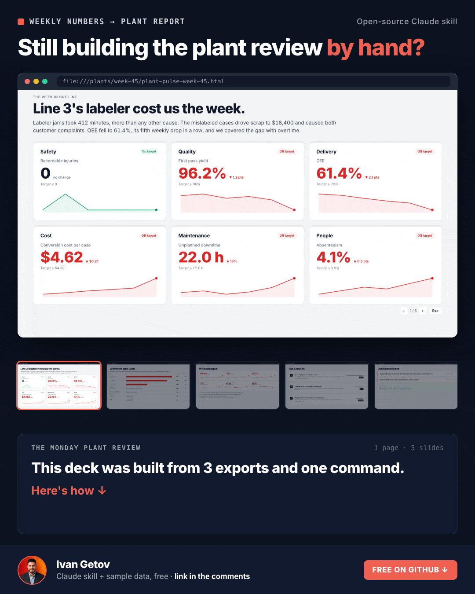
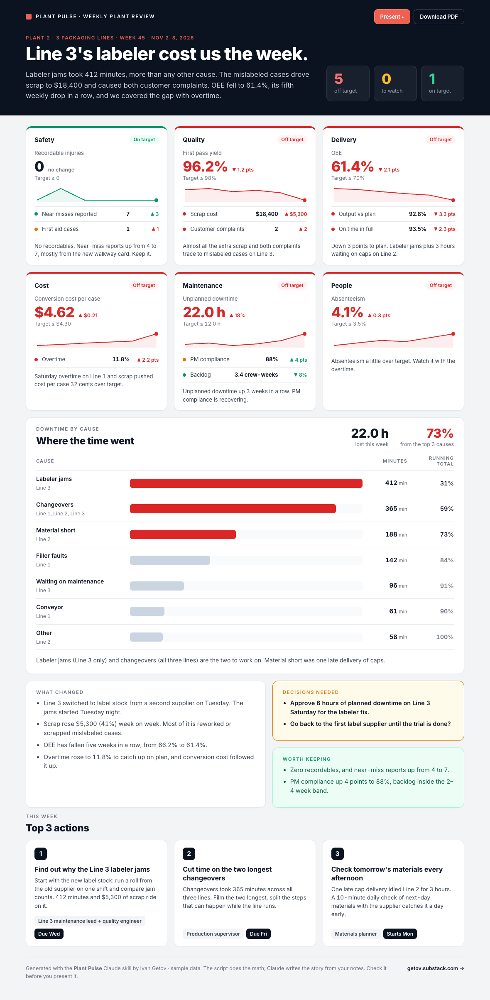

# Plant Pulse

**Turn your weekly plant numbers into a report you can present on Monday.**

A Claude skill for plant managers, ops leaders and maintenance managers. Give it this week's numbers (safety, quality, delivery, cost, maintenance, people), your downtime log and the supervisors' notes. You get one HTML file with:

- **A one-page brief**: the week in one line, a scorecard by category with trends against your targets, a downtime Pareto, what changed, top 3 actions with owners, and the decisions you need from the plant manager. Prints to PDF.
- **A 5-slide deck** of the same week: press **P** to present. Scorecard → Where the time went → What changed → Top 3 actions → Decisions needed.



<details><summary>The one-page brief (full size)</summary>



</details>

## How it works

1. **Claude reads whatever you have.** CSV or Excel exports, a pasted table, a folder of files. It reshapes them into one `weekly_metrics.csv` (and a downtime log, if you have one). If a target is missing, it asks you. It never makes one up.
2. **A Python script does the math.** Status against target, week-over-week change, how many weeks in a row a number has moved, and the downtime Pareto. No formula lives in the AI's head.
3. **Claude writes the story** from those numbers and your notes: the headline that connects the red across categories, what changed and why, three actions with owners, and the yes/no decisions.
4. **The script builds the report.** One self-contained HTML file. No server, no login, nothing to install beyond Python 3.

The split matters. The math is exact and repeatable. The story is Claude's best read of your notes, so check it before you present it.

## Try it

You need [Claude Code](https://claude.com/claude-code) and Python 3.

```bash
git clone https://github.com/ivanegetov-lab/plant-pulse ~/.claude/skills/plant-pulse
```

Then, in Claude Code, from a folder with your weekly exports:

```
/plant-pulse
```

or just ask: *"Turn this week's numbers into a plant pulse report."*

To see the output first, open [`examples/plant-pulse-week-45.html`](examples/plant-pulse-week-45.html) in a browser and press **P**.

To run the script yourself on the sample data:

```bash
python3 scripts/plant_pulse.py analyze --metrics examples/weekly_metrics.csv --downtime examples/downtime_log.csv
python3 scripts/plant_pulse.py render --metrics examples/weekly_metrics.csv --downtime examples/downtime_log.csv \
  --narrative examples/narrative.json --out report.html
```

## Input format

`weekly_metrics.csv`, one row per metric:

| column | meaning |
|---|---|
| `category` | Safety, Quality, Delivery, Cost, Maintenance, People (or your own) |
| `metric` | the name your plant uses |
| `unit` | `%`, `$`, `count`, `h`, or any label |
| `direction` | `higher`, `lower`, or `band:2-4` |
| `current`, `target` | this week, and your target |
| `amber` | optional "watch" limit (blank = within 5% of target) |
| `last_week`, `w-5`…`w-2` | optional history for the trend lines |

`downtime_log.csv`: `line,cause,minutes`. `notes.md`: anything in plain text.

## Limits

- The sample plant and all its numbers are made up.
- It reports on the numbers you give it. It doesn't connect to your MES, historian or CMMS. Export first, then run it.
- The story can be wrong when the notes are thin. An SME should read it before it goes in front of the plant manager.
- Your data stays on your machine except for what Claude Code sends to the model. Check your company's AI policy before using real plant data.

## About

Built by [Ivan Getov](https://www.linkedin.com/in/ivan-getov-mba/), chemical engineer and manufacturing excellence leader, author of *Fix the System: A Maintenance Manager's Field Manual*. Free maintenance tools at [tools.getov.xyz](https://tools.getov.xyz). Weekly notes at [getov.substack.com](https://getov.substack.com).

MIT license.
